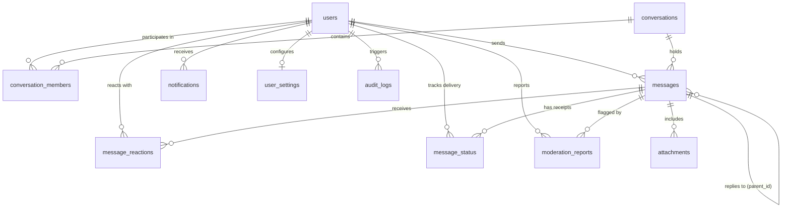

# CONNECTX – DATABASE DESIGN & ENTITY-RELATIONSHIP SPECIFICATION
**Project Title:** ConnectX – Python-Based Real-Time Multi-User Chat System  

---

## 1. Database Overview

ConnectX utilizes a normalized relational database schema (3rd Normal Form) implemented on **SQLite 3** via **Flask-SQLAlchemy**. The schema manages user profiles, group hierarchies, private discussions, message threading, sentiment scores, spam diagnostics, attachments, read receipts, emoji reactions, and administrative audit trails.

---

## 2. Entity-Relationship (ER) Diagram

---

## 3. Data Dictionary

### 1. `users` Table
Stores registered account credentials, status, and role.
* `id` (`INTEGER`, Primary Key, Auto Increment)
* `username` (`VARCHAR(64)`, Unique, Not Null, Indexed)
* `email` (`VARCHAR(120)`, Unique, Not Null, Indexed)
* `password_hash` (`VARCHAR(256)`, Not Null)
* `full_name` (`VARCHAR(100)`, Not Null, Default `''`)
* `bio` (`TEXT`, Default `'Hey there! I am using ConnectX.'`)
* `avatar` (`VARCHAR(256)`, Default `'default_avatar.svg'`)
* `status_message` (`VARCHAR(128)`, Default `'Available'`)
* `is_online` (`BOOLEAN`, Not Null, Default `0`)
* `last_seen` (`DATETIME`, Default `CURRENT_TIMESTAMP`)
* `role` (`VARCHAR(20)`, Not Null, Default `'user'`) – Options: `'admin'`, `'moderator'`, `'user'`
* `is_banned` (`BOOLEAN`, Not Null, Default `0`)
* `created_at` (`DATETIME`, Default `CURRENT_TIMESTAMP`)
* `updated_at` (`DATETIME`, Default `CURRENT_TIMESTAMP`)

### 2. `conversations` Table
Stores chat channels (1-to-1 direct and multi-user groups).
* `id` (`INTEGER`, Primary Key, Auto Increment)
* `type` (`VARCHAR(20)`, Not Null, Default `'direct'`) – `'direct'` or `'group'`
* `title` (`VARCHAR(128)`, Nullable)
* `description` (`TEXT`, Nullable)
* `icon` (`VARCHAR(256)`, Default `'default_group.svg'`)
* `creator_id` (`INTEGER`, Foreign Key $\rightarrow$ `users.id`, Nullable)
* `created_at` (`DATETIME`, Default `CURRENT_TIMESTAMP`)
* `updated_at` (`DATETIME`, Default `CURRENT_TIMESTAMP`, Indexed)

### 3. `conversation_members` Table
Association table representing user membership in conversations.
* `id` (`INTEGER`, Primary Key, Auto Increment)
* `conversation_id` (`INTEGER`, Foreign Key $\rightarrow$ `conversations.id` ON DELETE CASCADE, Not Null)
* `user_id` (`INTEGER`, Foreign Key $\rightarrow$ `users.id` ON DELETE CASCADE, Not Null)
* `role` (`VARCHAR(20)`, Not Null, Default `'member'`) – `'admin'`, `'moderator'`, `'member'`
* `joined_at` (`DATETIME`, Default `CURRENT_TIMESTAMP`)
* `last_read_message_id` (`INTEGER`, Default `0`)
* `is_muted` (`BOOLEAN`, Not Null, Default `0`)
* **Unique Constraint:** `(conversation_id, user_id)`

### 4. `messages` Table
Stores conversation messages with pure Python NLP annotations and threading.
* `id` (`INTEGER`, Primary Key, Auto Increment)
* `conversation_id` (`INTEGER`, Foreign Key $\rightarrow$ `conversations.id` ON DELETE CASCADE, Not Null, Indexed)
* `sender_id` (`INTEGER`, Foreign Key $\rightarrow$ `users.id` ON DELETE SET NULL, Nullable, Indexed)
* `parent_id` (`INTEGER`, Foreign Key $\rightarrow$ `messages.id` ON DELETE SET NULL, Nullable)
* `content` (`TEXT`, Not Null)
* `message_type` (`VARCHAR(20)`, Not Null, Default `'text'`)
* `category` (`VARCHAR(30)`, Not Null, Default `'general'`)
* `sentiment_score` (`FLOAT`, Default `0.0`)
* `sentiment_label` (`VARCHAR(20)`, Default `'neutral'`)
* `is_spam` (`BOOLEAN`, Not Null, Default `0`)
* `spam_score` (`FLOAT`, Default `0.0`)
* `is_deleted` (`BOOLEAN`, Not Null, Default `0`)
* `is_edited` (`BOOLEAN`, Not Null, Default `0`)
* `created_at` (`DATETIME`, Default `CURRENT_TIMESTAMP`, Indexed)
* `updated_at` (`DATETIME`, Default `CURRENT_TIMESTAMP`)

### 5. `attachments` Table
Stores uploaded media and files.
* `id` (`INTEGER`, Primary Key, Auto Increment)
* `message_id` (`INTEGER`, Foreign Key $\rightarrow$ `messages.id` ON DELETE CASCADE, Not Null, Indexed)
* `filename` (`VARCHAR(256)`, Not Null)
* `original_filename` (`VARCHAR(256)`, Not Null)
* `file_type` (`VARCHAR(50)`, Not Null)
* `mime_type` (`VARCHAR(100)`, Not Null)
* `file_size` (`INTEGER`, Not Null)
* `file_url` (`VARCHAR(512)`, Not Null)
* `created_at` (`DATETIME`, Default `CURRENT_TIMESTAMP`)

### 6. `message_status` Table (Read Receipts)
Tracks delivery and read acknowledgments.
* `id` (`INTEGER`, Primary Key, Auto Increment)
* `message_id` (`INTEGER`, Foreign Key $\rightarrow$ `messages.id` ON DELETE CASCADE, Not Null)
* `user_id` (`INTEGER`, Foreign Key $\rightarrow$ `users.id` ON DELETE CASCADE, Not Null)
* `delivered_at` (`DATETIME`, Default `CURRENT_TIMESTAMP`)
* `read_at` (`DATETIME`, Nullable)
* **Unique Constraint:** `(message_id, user_id)`

### 7. `message_reactions` Table
Stores emoji reactions per message.
* `id` (`INTEGER`, Primary Key, Auto Increment)
* `message_id` (`INTEGER`, Foreign Key $\rightarrow$ `messages.id` ON DELETE CASCADE, Not Null)
* `user_id` (`INTEGER`, Foreign Key $\rightarrow$ `users.id` ON DELETE CASCADE, Not Null)
* `reaction` (`VARCHAR(20)`, Not Null)
* `created_at` (`DATETIME`, Default `CURRENT_TIMESTAMP`)
* **Unique Constraint:** `(message_id, user_id, reaction)`

### 8. `notifications` Table
Stores real-time alerts.
* `id` (`INTEGER`, Primary Key, Auto Increment)
* `user_id` (`INTEGER`, Foreign Key $\rightarrow$ `users.id` ON DELETE CASCADE, Not Null, Indexed)
* `actor_id` (`INTEGER`, Foreign Key $\rightarrow$ `users.id` ON DELETE SET NULL, Nullable)
* `type` (`VARCHAR(32)`, Not Null)
* `title` (`VARCHAR(128)`, Not Null)
* `content` (`TEXT`, Not Null)
* `link_url` (`VARCHAR(256)`, Nullable)
* `is_read` (`BOOLEAN`, Not Null, Default `0`)
* `created_at` (`DATETIME`, Default `CURRENT_TIMESTAMP`)

### 9. `user_settings` Table
Stores user UI and sound preferences.
* `id` (`INTEGER`, Primary Key, Auto Increment)
* `user_id` (`INTEGER`, Foreign Key $\rightarrow$ `users.id` ON DELETE CASCADE, Not Null, Unique)
* `theme` (`VARCHAR(16)`, Not Null, Default `'light'`)
* `sound_enabled` (`BOOLEAN`, Not Null, Default `1`)
* `desktop_notifications` (`BOOLEAN`, Not Null, Default `1`)
* `enter_is_send` (`BOOLEAN`, Not Null, Default `1`)
* `updated_at` (`DATETIME`, Default `CURRENT_TIMESTAMP`)

### 10. `audit_logs` Table
Immutable administrative audit record.
* `id` (`INTEGER`, Primary Key, Auto Increment)
* `user_id` (`INTEGER`, Foreign Key $\rightarrow$ `users.id`, Nullable)
* `action` (`VARCHAR(64)`, Not Null)
* `target_type` (`VARCHAR(32)`, Nullable)
* `target_id` (`INTEGER`, Nullable)
* `details` (`TEXT`, Nullable)
* `ip_address` (`VARCHAR(45)`, Nullable)
* `created_at` (`DATETIME`, Default `CURRENT_TIMESTAMP`)
