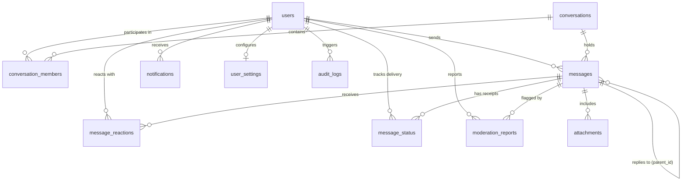
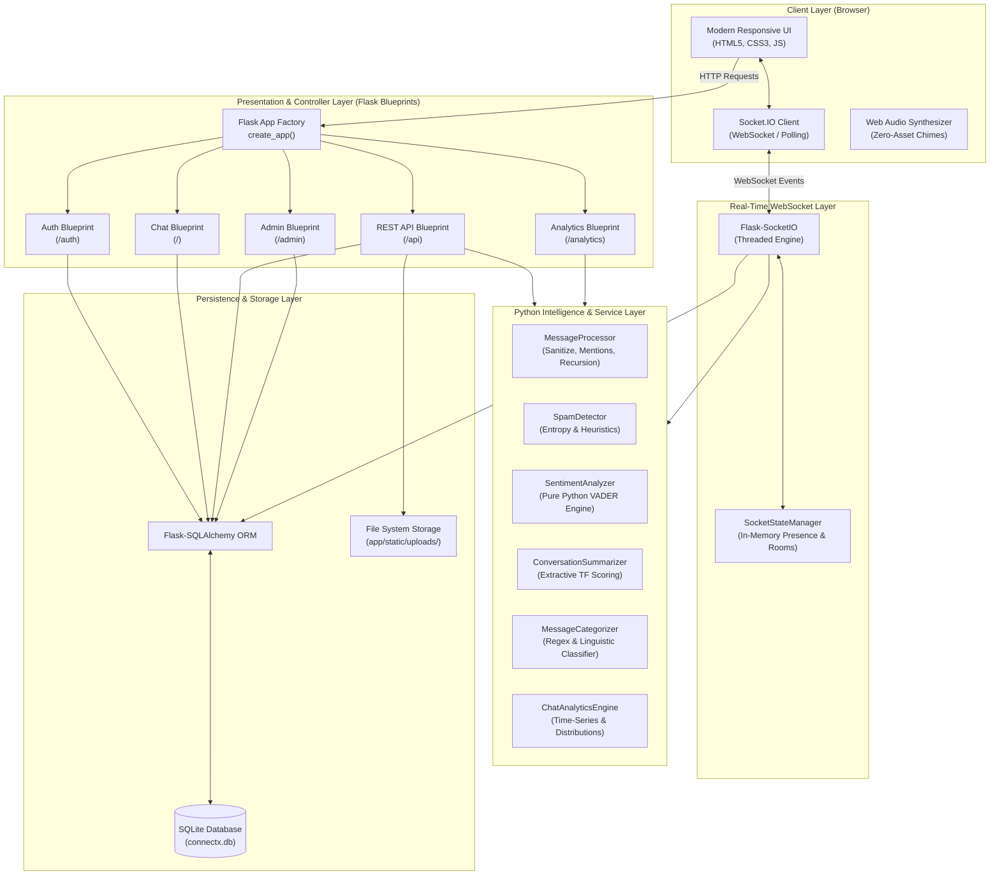
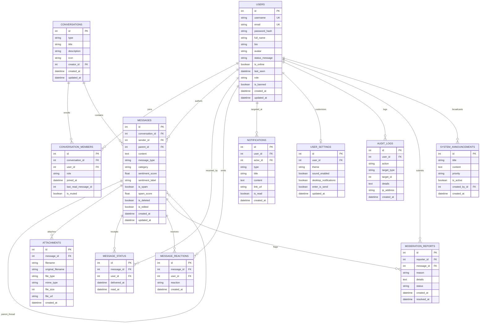
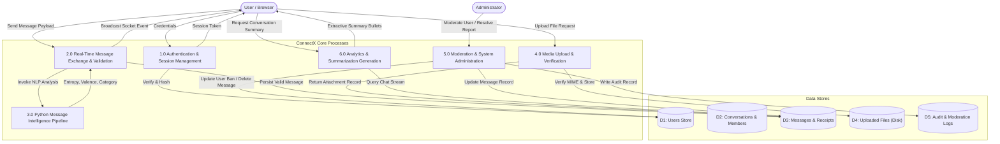
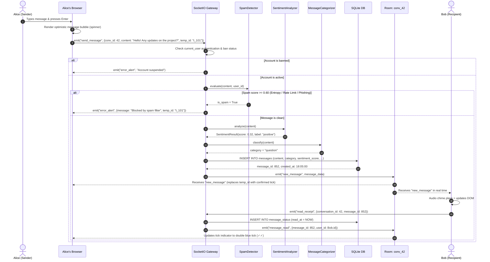

# CONNECTX – SYSTEM ARCHITECTURE SPECIFICATION
**Project Title:** ConnectX – Python-Based Real-Time Multi-User Chat System  
**Role:** Senior Software Architect, Database Designer & Academic Supervisor  

---

## 1. Executive Summary & Academic Objective

**ConnectX** is an enterprise-grade, real-time, multi-user messaging system architected using pure Python on the backend (Flask, Flask-SocketIO, Flask-SQLAlchemy, Flask-Login, SQLite) with a responsive, modern frontend (HTML5, CSS3, JavaScript, WebSockets).

The project is structured according to the **Application Factory Pattern** and **Layered Modular Architecture** (Routes $\rightarrow$ Services $\rightarrow$ Data Models $\rightarrow$ Database, with an asynchronous WebSocket pipeline). It adheres strictly to PEP 8 standards and demonstrates all required core Python curriculum competencies: object-oriented programming, data structures, recursion, file operations, custom exceptions, mathematical and algorithmic NLP (without external paid AI services), and automated test suites.

---

## 2. Comprehensive Module Decomposition

The platform is decomposed into twelve dedicated, decoupled modules:

### Module 1: Authentication & User Management
* **Purpose:** Handles account lifecycle, cryptographic credential hashing, role-based authorization, and user profiles.
* **Responsibilities:**
  - Secure registration with unique constraint validation and email verification regex.
  - Password hashing via PBKDF2-HMAC-SHA256 (`werkzeug.security`).
  - Session state management via `Flask-Login` (`UserMixin`, session cookie flags: `HttpOnly`, `SameSite=Lax`).
  - User profile management: bio, display status, and avatar uploads (with Pillow image processing and secure UUID filenames).
  - Account status enforcement: active, suspended/banned checks at both HTTP and WebSocket handshakes.

### Module 2: Private (1-to-1) Messaging
* **Purpose:** Manages confidential direct peer-to-peer conversations between two registered users.
* **Responsibilities:**
  - Idempotent conversation lookup: ensures only a single direct channel exists between any pair of users.
  - End-to-end conversation metadata tracking and unread message counters.
  - Peer authorization: only mutual participants can read or query message history.

### Module 3: Group Messaging & Channel Management
* **Purpose:** Enables multi-user collaborative group channels with administrative access control.
* **Responsibilities:**
  - Dynamic group creation with custom title, description, and group avatar icon.
  - Role-based channel permissions: `Admin` (creator), `Moderator`, and `Member`.
  - Membership operations: inviting users, removing members, transferring administrative rights, leaving groups.
  - System event announcements injected into channel streams upon membership changes.

### Module 4: Real-Time Communication (WebSocket Engine)
* **Purpose:** Provides bidirectional, low-latency communication via `Flask-SocketIO`.
* **Responsibilities:**
  - Connection multiplexing and room isolation: `conv_{conversation_id}` and private user alert channels `user_{user_id}`.
  - Protocol events: `connect`, `disconnect`, `join_conversation`, `leave_conversation`, `send_message`, `typing`, `read_receipt`, `add_reaction`.
  - In-memory thread-safe connection and presence tracking (`SocketStateManager` with `threading.RLock`).

### Module 5: Message Management & Threading
* **Purpose:** Manages message persistence, soft-deletions, editing, reactions, and threaded discussions.
* **Responsibilities:**
  - Message schema supporting text, media attachments, system alerts, and code snippets.
  - Threaded replies using self-referencing foreign keys (`parent_id`), supporting recursive thread tree generation.
  - Soft deletion flags (`is_deleted`) to preserve audit trails and conversation structural integrity.
  - Emoji reaction toggles with real-time room synchronization.

### Module 6: Secure File & Media Sharing
* **Purpose:** Allows uploading and distributing documents, images, and audio attachments.
* **Responsibilities:**
  - MIME-type validation and strict file extension whitelisting (`png`, `jpg`, `webp`, `pdf`, `txt`, `docx`, `mp3`).
  - Payload size constraints ($16\text{ MB}$ max via Flask config).
  - Sanitization of uploaded filenames using `werkzeug.utils.secure_filename` prefixed with unique UUID hex digests.
  - Static media distribution with HTTP caching headers.

### Module 7: Notification System
* **Purpose:** Keeps users informed of incoming communications, mentions, and administrative broadcasts.
* **Responsibilities:**
  - Synthesized client-side audio cues via HTML5 Web Audio API (cross-browser zero-dependency synthesizer).
  - In-app toast alerts and dynamic unread badge increments.
  - Real-time notification emission to `user_{id}` personal socket rooms for background/unopened conversations.

### Module 8: User Presence & Activity Management
* **Purpose:** Tracks online/offline states and transient typing activities.
* **Responsibilities:**
  - Multi-tab presence handling: a user remains online if at least one socket connection is active.
  - Heartbeat and graceful disconnect handling updating `is_online` and `last_seen` timestamps.
  - Ephemeral typing status broadcasting with a 1.2-second debounce timer to prevent network flooding.

### Module 9: Message Search & Query Engine
* **Purpose:** Provides fast, filtered exploration across user message histories.
* **Responsibilities:**
  - Case-insensitive substring matching (`ilike`) constrained strictly to conversations the querying user belongs to.
  - Multi-attribute filtering: query term, message semantic category, sentiment polarity, and date range.
  - Paginated query responses with cursor-based pagination (`before_id`).

### Module 10: Python Message Intelligence (Academic Showcase)
* **Purpose:** Pure Python Natural Language Processing without paid or external AI APIs.
* **Responsibilities:**
  - **Spam Filtering:** Shannon Entropy calculation ($H(X) = -\sum P(x)\log_2 P(x)$), uppercase character ratios, phrase heuristics, and sliding window rate limits.
  - **Rule-Based Sentiment Analysis:** VADER-inspired engine with word valences, negation window tracking (flipping polarity by $-0.74$), booster word multipliers, emoji valence scoring, and hyperbolic normalization $\frac{x}{\sqrt{x^2 + 15}}$.
  - **Message Categorization:** Linguistic pattern classification (Question, Code, Action Item, Announcement, Greeting, General).
  - **Conversation Summarization:** Extractive summarizer calculating stopword-filtered term frequency (TF) scoring, decision markers, and participant contribution weights.
  - **Text Sanitization & Recursion:** Profanity masking, user mention parsing (`@username`), and recursive tree construction of nested discussion replies.

### Module 11: Chat Analytics & Metrics Engine
* **Purpose:** Aggregates chat stream metrics for reporting and data visualization.
* **Responsibilities:**
  - Aggregation of message throughput, mean message lengths, and vocabulary frequency distributions.
  - 24-hour temporal activity histograms.
  - Sentiment polarity percentages and active participant leaderboards.

### Module 12: Administration & Moderation
* **Purpose:** Gives administrators and moderators full governance over platform safety and integrity.
* **Responsibilities:**
  - User suspension/reactivation (`is_banned`), preventing login and disconnecting active sockets.
  - Moderation report management for flagged abusive/spam messages.
  - Immutable audit logging (`AuditLog`) capturing administrative actions, timestamps, and client IP addresses.
  - System-wide broadcast announcement banners.

---

## 3. Database Planning & Data Dictionary

The database is built on relational principles using SQLite (via `Flask-SQLAlchemy`). The schema is normalized (3NF) to maintain data consistency.



### Table 1: `users`
Stores registered user credentials, profile information, and account status.

| Column Name | Data Type | PK/FK | Constraints | Description |
| :--- | :--- | :--- | :--- | :--- |
| `id` | `INTEGER` | **PK** | `AUTOINCREMENT` | Unique identifier for user |
| `username` | `VARCHAR(64)` | None | `NOT NULL, UNIQUE, INDEX` | Lowercase alphanumeric handle |
| `email` | `VARCHAR(120)` | None | `NOT NULL, UNIQUE, INDEX` | Valid email address |
| `password_hash` | `VARCHAR(256)`| None | `NOT NULL` | PBKDF2 hashed password string |
| `full_name` | `VARCHAR(100)`| None | `NOT NULL, DEFAULT ''` | User's display name |
| `bio` | `TEXT` | None | `DEFAULT ''` | Brief biographical snippet |
| `avatar` | `VARCHAR(256)`| None | `DEFAULT 'default_avatar.svg'` | Filename of uploaded avatar |
| `status_message`| `VARCHAR(128)`| None | `DEFAULT 'Available'` | Ephemeral status headline |
| `is_online` | `BOOLEAN` | None | `NOT NULL, DEFAULT 0` | Current online state |
| `last_seen` | `DATETIME` | None | `DEFAULT CURRENT_TIMESTAMP` | Last activity timestamp |
| `role` | `VARCHAR(20)` | None | `NOT NULL, DEFAULT 'user'` | 'admin', 'moderator', or 'user' |
| `is_banned` | `BOOLEAN` | None | `NOT NULL, DEFAULT 0` | Account suspension status |
| `created_at` | `DATETIME` | None | `DEFAULT CURRENT_TIMESTAMP` | Registration date |
| `updated_at` | `DATETIME` | None | `DEFAULT CURRENT_TIMESTAMP` | Record modification date |

* **Indexes:** `idx_users_username` (`username`), `idx_users_email` (`email`).

---

### Table 2: `conversations`
Stores chat channels (both 1-to-1 direct and multi-user groups).

| Column Name | Data Type | PK/FK | Constraints | Description |
| :--- | :--- | :--- | :--- | :--- |
| `id` | `INTEGER` | **PK** | `AUTOINCREMENT` | Unique identifier for conversation |
| `type` | `VARCHAR(20)` | None | `NOT NULL, DEFAULT 'direct'`| 'direct' or 'group' |
| `title` | `VARCHAR(128)`| None | `NULLABLE` | Group title (null for direct) |
| `description` | `TEXT` | None | `NULLABLE` | Group channel purpose |
| `icon` | `VARCHAR(256)`| None | `DEFAULT 'default_group.svg'` | Channel icon graphic |
| `creator_id` | `INTEGER` | **FK** | `REFERENCES users(id)` | Creator user ID |
| `created_at` | `DATETIME` | None | `DEFAULT CURRENT_TIMESTAMP` | Creation timestamp |
| `updated_at` | `DATETIME` | None | `DEFAULT CURRENT_TIMESTAMP, INDEX` | Timestamp of latest message |

* **Indexes:** `idx_conversations_updated_at` (`updated_at DESC`).

---

### Table 3: `conversation_members`
Association table linking users to conversations with role permissions and read tracking.

| Column Name | Data Type | PK/FK | Constraints | Description |
| :--- | :--- | :--- | :--- | :--- |
| `id` | `INTEGER` | **PK** | `AUTOINCREMENT` | Unique membership record ID |
| `conversation_id`| `INTEGER` | **FK** | `NOT NULL, REFERENCES conversations(id) ON DELETE CASCADE` | Target channel |
| `user_id` | `INTEGER` | **FK** | `NOT NULL, REFERENCES users(id) ON DELETE CASCADE` | Member user |
| `role` | `VARCHAR(20)` | None | `NOT NULL, DEFAULT 'member'`| 'admin', 'moderator', 'member' |
| `joined_at` | `DATETIME` | None | `DEFAULT CURRENT_TIMESTAMP` | Join timestamp |
| `last_read_message_id`| `INTEGER` | None | `DEFAULT 0` | Pointer to last read message |
| `is_muted` | `BOOLEAN` | None | `NOT NULL, DEFAULT 0` | Mute notification preference |

* **Constraints:** `UNIQUE(conversation_id, user_id)` (prevents duplicate membership).
* **Indexes:** `idx_member_lookup` (`conversation_id`, `user_id`).

---

### Table 4: `messages`
Stores message content, threading hierarchy, and Python NLP metadata.

| Column Name | Data Type | PK/FK | Constraints | Description |
| :--- | :--- | :--- | :--- | :--- |
| `id` | `INTEGER` | **PK** | `AUTOINCREMENT` | Unique message ID |
| `conversation_id`| `INTEGER` | **FK** | `NOT NULL, REFERENCES conversations(id) ON DELETE CASCADE, INDEX` | Channel ID |
| `sender_id` | `INTEGER` | **FK** | `NULLABLE, REFERENCES users(id) ON DELETE SET NULL, INDEX` | Sender ID |
| `parent_id` | `INTEGER` | **FK** | `NULLABLE, REFERENCES messages(id) ON DELETE SET NULL` | Parent for reply threads |
| `content` | `TEXT` | None | `NOT NULL` | Sanitized message body |
| `message_type` | `VARCHAR(20)` | None | `NOT NULL, DEFAULT 'text'` | 'text', 'file', 'image', 'system' |
| `category` | `VARCHAR(30)` | None | `NOT NULL, DEFAULT 'general'` | 'question', 'code', 'action_item', etc. |
| `sentiment_score`| `FLOAT` | None | `DEFAULT 0.0` | Compound score in range $[-1.0, 1.0]$ |
| `sentiment_label`| `VARCHAR(20)` | None | `DEFAULT 'neutral'` | 'positive', 'neutral', 'negative' |
| `is_spam` | `BOOLEAN` | None | `NOT NULL, DEFAULT 0` | Spam filter decision |
| `spam_score` | `FLOAT` | None | `DEFAULT 0.0` | Probability score $[0.0, 1.0]$ |
| `is_deleted` | `BOOLEAN` | None | `NOT NULL, DEFAULT 0` | Soft-delete flag |
| `is_edited` | `BOOLEAN` | None | `NOT NULL, DEFAULT 0` | Edit indicator |
| `created_at` | `DATETIME` | None | `DEFAULT CURRENT_TIMESTAMP, INDEX` | Timestamp sent |
| `updated_at` | `DATETIME` | None | `DEFAULT CURRENT_TIMESTAMP` | Last modified timestamp |

* **Indexes:** `idx_messages_conv_created` (`conversation_id`, `created_at ASC`), `idx_messages_sender` (`sender_id`).

---

### Table 5: `attachments`
Stores metadata and disk paths for uploaded files and media.

| Column Name | Data Type | PK/FK | Constraints | Description |
| :--- | :--- | :--- | :--- | :--- |
| `id` | `INTEGER` | **PK** | `AUTOINCREMENT` | Unique attachment ID |
| `message_id` | `INTEGER` | **FK** | `NOT NULL, REFERENCES messages(id) ON DELETE CASCADE, INDEX` | Associated message |
| `filename` | `VARCHAR(256)`| None | `NOT NULL` | Sanitized UUID disk filename |
| `original_filename`| `VARCHAR(256)`| None | `NOT NULL` | Original client filename |
| `file_type` | `VARCHAR(50)` | None | `NOT NULL` | 'image', 'document', 'audio' |
| `mime_type` | `VARCHAR(100)`| None | `NOT NULL` | Valid MIME identifier |
| `file_size` | `INTEGER` | None | `NOT NULL` | Size in bytes |
| `file_url` | `VARCHAR(512)`| None | `NOT NULL` | Relative static URI |
| `created_at` | `DATETIME` | None | `DEFAULT CURRENT_TIMESTAMP` | Upload timestamp |

---

### Table 6: `message_status` (Read Receipts & Delivery Indicators)
Tracks delivery and read acknowledgments per recipient.

| Column Name | Data Type | PK/FK | Constraints | Description |
| :--- | :--- | :--- | :--- | :--- |
| `id` | `INTEGER` | **PK** | `AUTOINCREMENT` | Unique record ID |
| `message_id` | `INTEGER` | **FK** | `NOT NULL, REFERENCES messages(id) ON DELETE CASCADE` | Message referenced |
| `user_id` | `INTEGER` | **FK** | `NOT NULL, REFERENCES users(id) ON DELETE CASCADE` | Recipient user ID |
| `delivered_at`| `DATETIME` | None | `DEFAULT CURRENT_TIMESTAMP` | Delivery confirmation time |
| `read_at` | `DATETIME` | None | `NULLABLE` | Read confirmation time |

* **Constraints:** `UNIQUE(message_id, user_id)`.

---

### Table 7: `notifications`
Stores system and direct communication notifications for users.

| Column Name | Data Type | PK/FK | Constraints | Description |
| :--- | :--- | :--- | :--- | :--- |
| `id` | `INTEGER` | **PK** | `AUTOINCREMENT` | Unique notification ID |
| `user_id` | `INTEGER` | **FK** | `NOT NULL, REFERENCES users(id) ON DELETE CASCADE, INDEX` | Recipient user |
| `actor_id` | `INTEGER` | **FK** | `NULLABLE, REFERENCES users(id) ON DELETE SET NULL` | Triggering user |
| `type` | `VARCHAR(32)` | None | `NOT NULL` | 'mention', 'direct_message', 'invite' |
| `title` | `VARCHAR(128)`| None | `NOT NULL` | Short headline |
| `content` | `TEXT` | None | `NOT NULL` | Notification body |
| `link_url` | `VARCHAR(256)`| None | `NULLABLE` | Deep-link to conversation |
| `is_read` | `BOOLEAN` | None | `NOT NULL, DEFAULT 0` | Read state |
| `created_at` | `DATETIME` | None | `DEFAULT CURRENT_TIMESTAMP` | Emission timestamp |

---

### Table 8: `user_settings`
Stores user-specific UI preferences, theme choices, and privacy controls.

| Column Name | Data Type | PK/FK | Constraints | Description |
| :--- | :--- | :--- | :--- | :--- |
| `id` | `INTEGER` | **PK** | `AUTOINCREMENT` | Unique settings record |
| `user_id` | `INTEGER` | **FK** | `NOT NULL, UNIQUE, REFERENCES users(id) ON DELETE CASCADE` | Target user |
| `theme` | `VARCHAR(16)` | None | `NOT NULL, DEFAULT 'light'` | 'light' or 'dark' |
| `sound_enabled`| `BOOLEAN` | None | `NOT NULL, DEFAULT 1` | Play Web Audio cues |
| `desktop_notifications`| `BOOLEAN` | None | `NOT NULL, DEFAULT 1` | Allow push/toast alerts |
| `enter_is_send`| `BOOLEAN` | None | `NOT NULL, DEFAULT 1` | Enter submits message |
| `updated_at` | `DATETIME` | None | `DEFAULT CURRENT_TIMESTAMP` | Last updated time |

---

### Supplementary Tables: `message_reactions`, `audit_logs`, `moderation_reports`, `system_announcements`

* **`message_reactions`**: `(id PK, message_id FK, user_id FK, reaction VARCHAR(20), created_at DATETIME)` with `UNIQUE(message_id, user_id, reaction)`.
* **`audit_logs`**: `(id PK, user_id FK, action VARCHAR(64), target_type VARCHAR(32), target_id INTEGER, details TEXT, ip_address VARCHAR(45), created_at DATETIME)`.
* **`moderation_reports`**: `(id PK, reporter_id FK, message_id FK, reason VARCHAR(128), details TEXT, status VARCHAR(20) DEFAULT 'pending', created_at DATETIME, resolved_at DATETIME)`.
* **`system_announcements`**: `(id PK, title VARCHAR(128), content TEXT, priority VARCHAR(20) DEFAULT 'info', is_active BOOLEAN DEFAULT 1, created_by_id FK, created_at DATETIME)`.

---

## 4. Professional Flask Application Folder Structure

```
ConnectX/
│
├── app/                                 # Primary Application Package
│   ├── __init__.py                      # Application Factory: create_app()
│   ├── config.py                        # Environment Configs (Development, Testing, Production)
│   ├── extensions.py                    # Extensions: db, login_manager, socketio, csrf
│   │
│   ├── models/                          # Database Domain Entities
│   │   ├── __init__.py                  # Exposes all SQLAlchemy models
│   │   ├── user.py                      # User, UserSettings
│   │   ├── chat.py                      # Conversation, ConversationParticipant, Message, Attachment
│   │   ├── status.py                    # ReadReceipt, MessageReaction, Notification
│   │   └── audit.py                     # AuditLog, ModerationReport, SystemAnnouncement
│   │
│   ├── routes/                          # Blueprints (Controller Layer)
│   │   ├── __init__.py                  # Blueprint registration helper
│   │   ├── auth.py                      # /auth: Login, Register, Logout, Profile
│   │   ├── chat.py                      # /: 3-pane chat interface, direct routing
│   │   ├── api.py                       # /api: REST endpoints for messages, groups, upload
│   │   ├── admin.py                     # /admin: Dashboard, bans, report moderation
│   │   └── analytics.py                 # /analytics: Academic NLP interactive lab & metrics
│   │
│   ├── services/                        # Business Logic & Python Message Intelligence
│   │   ├── __init__.py
│   │   ├── message_processor.py         # Text sanitization, regex mentions, recursive thread tree
│   │   ├── spam_detector.py             # Shannon entropy, rate limiting, heuristic scoring
│   │   ├── sentiment_analyzer.py        # Rule-based VADER sentiment analyzer in pure Python
│   │   ├── summarizer.py                # Extractive TF-IDF / sentence-scoring summarizer
│   │   ├── categorizer.py               # Pattern & keyword message classifier
│   │   ├── analytics_engine.py          # Descriptive statistics, distributions, time-series
│   │   └── academic_showcase.py         # 15 core curriculum Python demonstrations
│   │
│   ├── sockets/                         # WebSocket Handlers (Flask-SocketIO)
│   │   ├── __init__.py                  # Socket events registration
│   │   ├── events.py                    # connect, disconnect, send_message, typing, receipts
│   │   └── state.py                     # Thread-safe in-memory presence & room tracker
│   │
│   ├── utils/                           # Cross-Cutting Utilities & Helpers
│   │   ├── __init__.py
│   │   ├── decorators.py                # @admin_required, @moderator_required
│   │   ├── validators.py                # File extension checks, regex validators
│   │   └── file_storage.py              # Secure UUID file handling & upload logic
│   │
│   ├── static/                          # Client Static Assets
│   │   ├── css/
│   │   │   ├── style.css                # Global design system, theme variables, modals, buttons
│   │   │   ├── chat.css                 # 3-pane layout, bubbles, reactions, typing dots
│   │   │   └── admin.css                # Tables, stat cards, analytics dashboard charts
│   │   ├── js/
│   │   │   ├── main.js                  # Theme switcher, Web Audio synthesizer, toasts, modals
│   │   │   ├── socket.js                # SocketIO client, reconnection, presence listeners
│   │   │   ├── chat.js                  # Chat interaction, message bubbles, attachments, typing
│   │   │   └── analytics.js             # Interactive NLP lab triggers and result renderers
│   │   ├── img/
│   │   │   └── logo.svg                 # ConnectX brand SVG vector graphic
│   │   └── uploads/                     # User-generated storage (excluded from git)
│   │       ├── avatars/                 # User avatars & group icons (contains defaults)
│   │       └── attachments/             # Chat files, images, and audio clips
│   │
│   └── templates/                       # Jinja2 Templates
│       ├── base.html                    # Root skeleton with navbar, theme toggle, flash banner
│       ├── auth/
│       │   ├── login.html               # Secure login form
│       │   ├── register.html            # Registration form
│       │   └── profile.html             # Profile edit & password update
│       ├── chat/
│       │   ├── index.html               # Complete 3-pane Discord/Slack-style interface
│       │   └── modals.html              # New chat, create group, manage members, summarizer
│       ├── admin/
│       │   ├── dashboard.html           # Metric cards, recent activity, system health
│       │   ├── users.html               # User listing, role assignments, ban controls
│       │   ├── reports.html             # Moderation queue and message deletion
│       │   ├── announcements.html       # Global banner broadcaster
│       │   └── audit_logs.html          # Immutable administrative audit log viewer
│       ├── analytics/
│       │   └── dashboard.html           # Visual charts, NLP interactive laboratory, syllabus audit
│       └── errors/
│           ├── 403.html                 # Forbidden error page
│           ├── 404.html                 # Not Found error page
│           └── 500.html                 # Internal Server Error page
│
├── instance/                            # Local Instance Directory
│   └── connectx.db                      # Local SQLite Database file
│
├── tests/                               # Automated Pytest Suite
│   ├── __init__.py
│   ├── conftest.py                      # Fixtures: test app, in-memory DB, auth client, socket test client
│   ├── test_auth.py                     # Registration, login, password security tests
│   ├── test_chat.py                     # Conversations, messages, attachments, participants
│   ├── test_python_features.py          # Unit tests for spam, sentiment, summarizer, categorizer
│   ├── test_sockets.py                  # Real-time WebSocket connection & dispatch tests
│   └── test_admin.py                    # Role authorization and moderation tests
│
├── docs/                                # Academic Deliverables
│   ├── PROJECT_REPORT.md                # Full academic report
│   ├── SYSTEM_ARCHITECTURE.md           # This comprehensive architecture document
│   ├── DATABASE_ER.md                   # Relational database schema & ER documentation
│   ├── VIVA_QUESTIONS_ANSWERS.md        # 50+ B.Tech Python viva questions & deep answers
│   └── PRESENTATION_OUTLINE.md          # Defense presentation slide deck outline
│
├── .env.example                         # Template for configuration environment variables
├── .gitignore                           # Git ignore rules (.db, uploads, __pycache__, .pytest_cache)
├── pytest.ini                           # Pytest configuration
├── requirements.txt                     # Pinned working dependencies
├── run.py                               # Application entrypoint
└── README.md                            # Comprehensive setup and run guide
```

---

## 5. Architectural Diagrams

### Diagram 1: System Architecture Diagram



---

### Diagram 2: System Use Case Diagram

```mermaid
flowchart LR
    subgraph Actors
        User((Registered User))
        Mod((Moderator))
        Admin((Administrator))
    end

    subgraph User_Cases ["Chat & Messaging Use Cases"]
        UC1[Register & Authenticate]
        UC2[Manage Profile & Avatar]
        UC3[Send 1-to-1 Private Messages]
        UC4[Create & Participate in Groups]
        UC5[Upload & Download Attachments]
        UC6[Search Message History]
        UC7[React with Emojis & View Receipts]
        UC8[Trigger Conversation Summary]
        UC9[Report Inappropriate Message]
    end

    subgraph Mod_Cases ["Moderation Use Cases"]
        UC10[Review Flagged Reports]
        UC11[Delete Inappropriate Messages]
    end

    subgraph Admin_Cases ["Administration & Analytics Use Cases"]
        UC12[Suspend / Reactivate Accounts]
        UC13[Assign Roles]
        UC14[Broadcast Announcements]
        UC15[Inspect Immutable Audit Logs]
        UC16[View Platform Analytics & Python Lab]
    end

    User --> UC1
    User --> UC2
    User --> UC3
    User --> UC4
    User --> UC5
    User --> UC6
    User --> UC7
    User --> UC8
    User --> UC9

    Mod ---|> User
    Mod --> UC10
    Mod --> UC11

    Admin ---|> Mod
    Admin --> UC12
    Admin --> UC13
    Admin --> UC14
    Admin --> UC15
    Admin --> UC16
```

---

### Diagram 3: Database Entity-Relationship (ER) Diagram



---

### Diagram 4: Level-1 Data Flow Diagram (DFD)



---

### Diagram 5: End-to-End Real-Time Message Delivery Flowchart



---

## 6. Phased Implementation Roadmap

| Phase | Milestone Name | Scope & Deliverables | Verification Strategy |
| :--- | :--- | :--- | :--- |
| **Phase 1** | **Scaffolding & Config** | Base directory structure, `requirements.txt`, `.env`, `pytest.ini`, `app/config.py`. | Directory audit and package import validation. |
| **Phase 2** | **Database Schema & Models** | SQLAlchemy models: `User`, `Conversation`, `ConversationParticipant`, `Message`, `Attachment`, `AuditLog`, `SystemAnnouncement`. | Unit testing schema constraints and relationships in `:memory:`. |
| **Phase 3** | **Python Intelligence Engines** | Pure Python algorithms: `MessageProcessor`, `SpamDetector`, `SentimentAnalyzer`, `ConversationSummarizer`, `MessageCategorizer`, `ChatAnalyticsEngine`, `academic_showcase.py`. | Dedicated Pytest unit tests for all mathematical and NLP assertions. |
| **Phase 4** | **Authentication & Profiles** | Blueprints for `auth` (`login`, `register`, `logout`, `profile`), password hashing, avatar upload. | Test client login sessions and CSRF handling. |
| **Phase 5** | **Real-Time Sockets & Chat API** | Flask-SocketIO handlers (`connect`, `disconnect`, `send_message`, `typing`, `read_receipt`, `reactions`), REST API endpoints for conversations, search, and uploads. | SocketIO test client event emission and room isolation checks. |
| **Phase 6** | **Frontend UI & Themes** | 3-pane responsive layout, dark/light theme switcher, Web Audio synthesized sounds, typing animations, reactions bar, search. | Browser UI functional validation and responsiveness verification. |
| **Phase 7** | **Administration & Analytics** | Admin dashboard, ban toggles, report resolution, system announcements, audit log browser, and interactive NLP lab. | Admin role-based access control tests. |
| **Phase 8** | **Seed Data & Automated Testing** | `seed_data.py` (sample accounts, groups, rich chat history) and complete Pytest test suite. | Automated execution of full test suite (100% pass rate). |
| **Phase 9** | **Academic Documentation** | Project Report (`PROJECT_REPORT.md`), Database ER (`DATABASE_ER.md`), Presentation Outline (`PRESENTATION_OUTLINE.md`), Viva Q&A (`VIVA_QUESTIONS_ANSWERS.md`). | Complete academic artifact delivery. |
